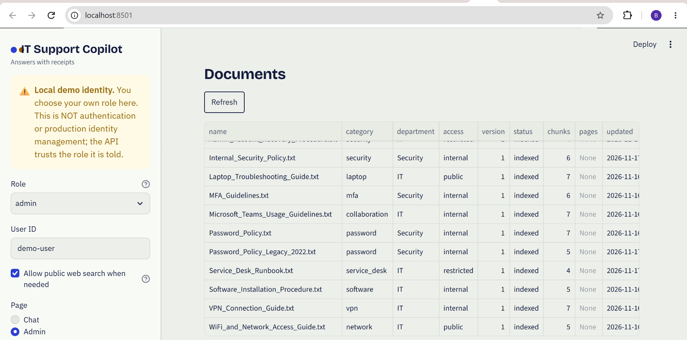
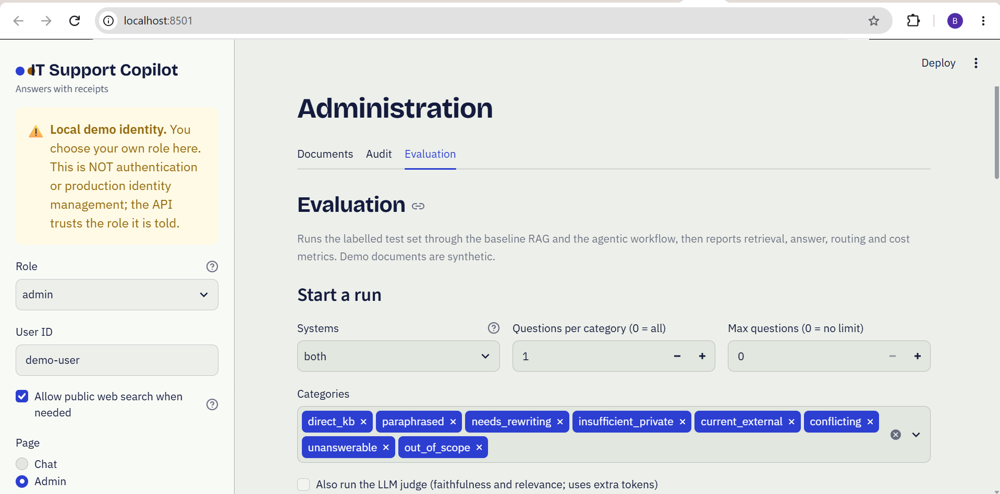
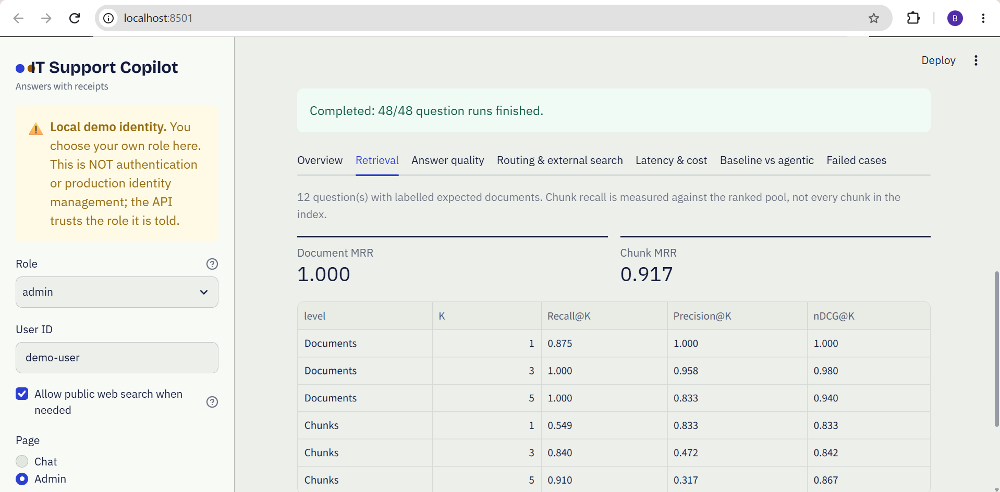
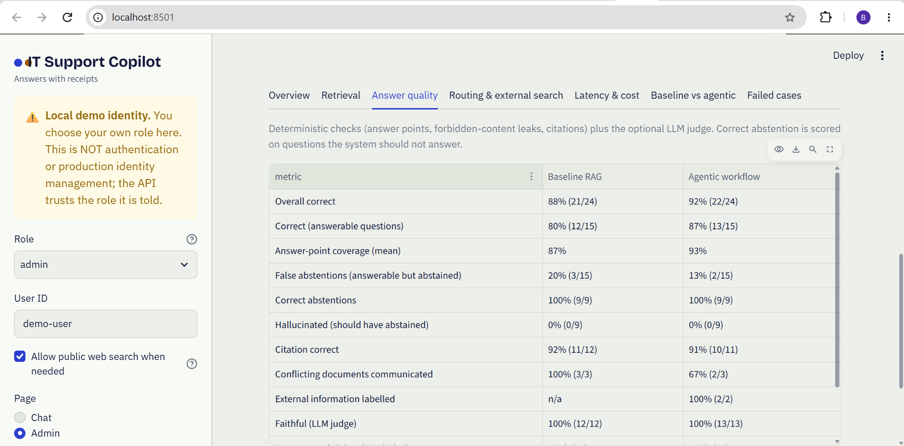
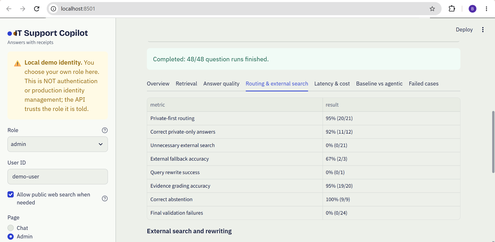
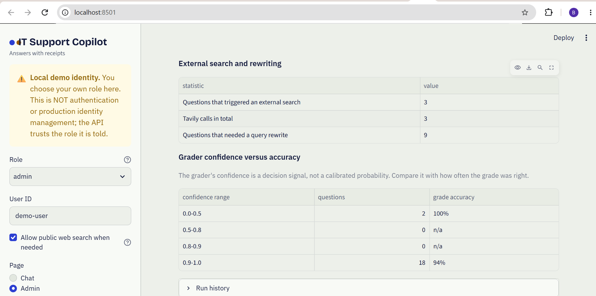
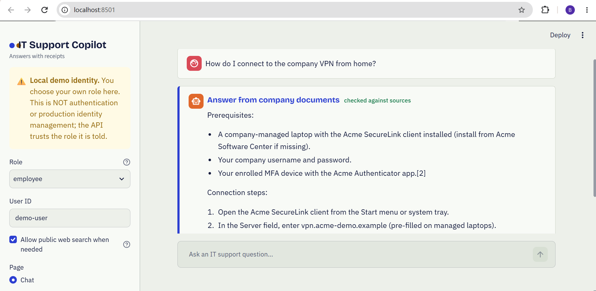
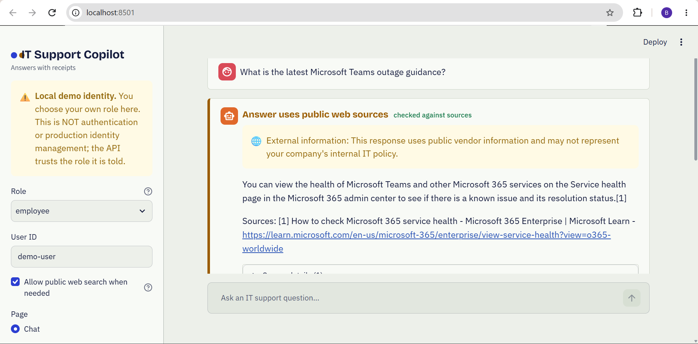
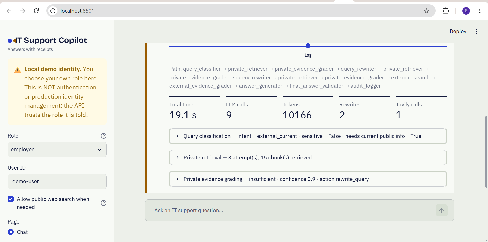
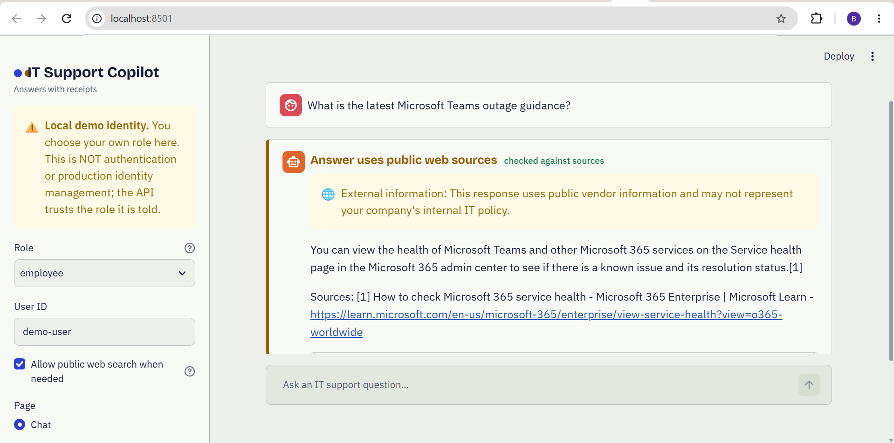

# IT Support Copilot: Private-First Agentic RAG


A locally runnable IT support assistant for employees. It answers from the company's **internal documents first**, grades the evidence it found, rewrites the query and retries when the evidence is weak, uses **public web search only as a graded, clearly labelled fallback**, cites every claim, **abstains** when reliable evidence is missing, and records the full decision path.

> **Demo data:** every document in `data/kb_documents/` is a **synthetic demo document, not a real company policy**. Each file starts with the line `SYNTHETIC DEMO DOCUMENT — NOT A REAL COMPANY POLICY`.
>
> **Demo auth:** the employee/admin roles are a **local demonstration, not authentication or production identity management** (see [Demo authorization](#demo-authorization-and-its-limits)).
>
> **Scope:** this project runs locally (virtualenv or Docker Compose). Deployment is out of scope.
>
> **What testing turned up:** [docs/FINDINGS.md](docs/FINDINGS.md) lists the defects found by measurement (a routing leak, an ingestion bug, four defects from a live demo), a reranker experiment that gave a negative result, and what is still unproven.

---

## Contents

1. [What it does](#what-it-does)
2. [Architecture](#architecture)
3. [Technology stack](#technology-stack)
4. [Project layout](#project-layout)
5. [What runs locally and what needs the internet](#what-runs-locally-and-what-needs-the-internet)
6. [Setup](#setup)
7. [Running the application](#running-the-application)
8. [Docker](#docker)
9. [Demo authorization and its limits](#demo-authorization-and-its-limits)
10. [Example workflows](#example-workflows)
11. [API](#api)
12. [Document ingestion](#document-ingestion)
13. [Evaluation](#evaluation)
14. [Testing](#testing)
15. [Limitations](#limitations)
16. [Screenshots](#screenshots)

---

## What it does

- Searches internal documents first, using semantic search over Pinecone with `all-MiniLM-L6-v2` embeddings.
- Grades the retrieved evidence (relevance, sufficiency, contradictions, outdated or incomplete content).
- Rewrites the query and retries retrieval when evidence is insufficient (bounded retries).
- Calls Tavily only when private evidence is still insufficient **and** the question has a public-information angle, external search is allowed, and the question contains nothing sensitive.
- Grades external results (credibility, relevance, freshness) and rejects weak ones.
- Generates an answer using only accepted evidence. Citations are resolved by code against real evidence, so the model cannot invent a source.
- Validates the final answer's grounding. If validation fails it revises once, then abstains.
- Shows the real graph execution trace in the UI and stores the full request lifecycle in SQLite.
- Lets an admin upload, re-index and delete documents, and run the evaluation suite.
- Compares the agentic workflow with a simple baseline RAG on the same dataset and corpus.

## Architecture


Node names above are the exact LangGraph node names.

### Routing rules (enforced in `src/copilot/graph/routing.py`)

1. **Private retrieval always runs first** for any in-scope question, even if the classifier says "current information".
2. **Tavily is never called just because the classifier predicts a current-information question.** It needs insufficient private evidence after retries (or a genuine need to supplement sufficient private evidence), the classifier's finding that the question needs current public information (intent `external_current` or `both`; the grader's recommendation alone is never enough), `EXTERNAL_SEARCH_ENABLED` plus the per-request flag, and no sensitive content in the question.
3. A failed retrieval alone is not proof that web search is appropriate: undocumented company-specific questions abstain.
4. Public information never overrides an internal policy, and external answers are labelled.
5. Every loop is bounded: `MAX_REWRITE_RETRIES` (default 2), `MAX_VALIDATION_REVISIONS` (default 1) and `GRAPH_RECURSION_LIMIT`.
6. Retrieved and external text is untrusted evidence, placed in delimited `<evidence>` blocks. It cannot change routing or instructions.
7. Answers that use external evidence start with exactly: `External information: This response uses public vendor information and may not represent your company's internal IT policy.`
8. When no reliable evidence exists the system abstains, recommends the IT Service Desk, and records the abstention reason. If the grader, validator or LLM is unavailable, it fails closed (abstains) rather than guessing.
9. A user-written community page (for example a Microsoft Q&A thread; URL paths such as `/answers/`, `/forums/` or `/t5/`) is never accepted as evidence, whatever credibility the grader gives it. The decision is made from the URL, in code. If only community pages are found, the answer abstains.
10. When a public source would have been relevant, an abstention says why none was used (web search switched off, turned off for this request, blocked because the message looks sensitive, no safe query could be formed, or the search service was unavailable). If the question contains something that looks like a password or secret, the abstention also asks the user to change it. These sentences are built from state flags in code, not written by the model.

Search queries are sanitised before leaving the machine (identifiers, private terms and secrets are removed or the search is blocked), and external URLs are validated.

**Audit records are redacted before they are written.** The question, the rewritten query, the whole decision trace, the grading and validation results and the final answer have credentials masked (API-key formats, `password = ...` style pairs, bearer tokens). The final answer and the trace keep long URLs and chunk ids intact, because only the credential patterns are applied there, not the "any 40-character token" rule that is used for typed text.

## Technology stack

| Layer | Technology |
|---|---|
| Agent workflow | LangGraph `StateGraph` (typed state, conditional edges, bounded loops) |
| LLM | Groq API (default model `openai/gpt-oss-120b`, set by `GROQ_MODEL`) |
| Embeddings | HuggingFace `sentence-transformers/all-MiniLM-L6-v2` (384 dimensions, runs locally) |
| Vector database | Pinecone serverless (cosine) |
| External search | Tavily |
| Backend | FastAPI + Pydantic v2 |
| Frontend | Streamlit (talks to the API over HTTP only) |
| Audit and metadata | SQLite |
| Packaging | Docker and Docker Compose |
| Language | Python 3.11+ (developed on 3.12) |

All configuration lives in one `Settings` class (`src/copilot/config.py`, read through `get_settings()`). Model names, thresholds, top-k, chunk sizes and URLs are not hard-coded elsewhere. Every variable is listed in `.env.example`.

## Project layout

```
it-support-copilot/
├── README.md, pyproject.toml, requirements.txt
├── .env.example               every setting (copy to .env; never commit .env)
├── Dockerfile, docker-compose.yml, .dockerignore
├── data/
│   ├── kb_documents/          11 synthetic demo documents
│   ├── eval/dataset.json      93 labelled evaluation questions in 8 categories
│   ├── eval/results/          evaluation run outputs (git-ignored)
│   └── sqlite/                app.db (git-ignored)
├── frontend/streamlit_app.py  Streamlit entry point
├── scripts/                   init_db, check_env, check_groq, ingest_kb, search_kb,
│                              ask_baseline, ask_agent, run_api, run_eval,
│                              eval_rerank_ab, calibrate_retrieval
├── src/copilot/
│   ├── config.py, logging_config.py, retry.py, utils.py
│   ├── auth/                  demo roles and access levels
│   ├── db/                    SQLite connection, schema, repository
│   ├── ingestion/             validators, loaders, cleaner, chunker, metadata, ids, pipeline
│   ├── embeddings/            MiniLM embedding service
│   ├── vectorstore/           Pinecone store and the access-filtered retriever
│   ├── llm/                   Groq client (structured output) and prompts
│   ├── search/                Tavily client, query sanitizer, URL validation
│   ├── generation/            evidence blocks, answer generator, citations
│   ├── validation/            citation marker checks
│   ├── graph/                 state, schemas, routing, builder, runner, nodes/ (one file per node)
│   ├── baseline/              baseline RAG (retrieve then generate)
│   ├── audit/                 audit logger and feedback store
│   ├── api/                   FastAPI app, schemas, security, services, routes/
│   ├── ui/                    API client, formatting helpers, views/ (chat, admin, evaluation)
│   └── evaluation/            dataset, metrics, scoring, judge, runner, service, reporting
└── tests/                     unit/, workflow/, api/, integration/
```

## What runs locally and what needs the internet

| Component | Where it runs | Needs |
|---|---|---|
| Embeddings (MiniLM) | Locally (in the Docker image the model is baked in) | Internet only on the first download |
| FastAPI, Streamlit, SQLite, LangGraph | Locally | Nothing |
| Groq LLM | Groq cloud | `GROQ_API_KEY`, internet |
| Pinecone vector index | Pinecone cloud | `PINECONE_API_KEY`, internet |
| Tavily web search | Tavily cloud | `TAVILY_API_KEY`, internet (optional: set `EXTERNAL_SEARCH_ENABLED=false` to disable) |

Unit, workflow and API tests use fakes and need no keys or network.

## Setup

**Prerequisites:** Python 3.11+, free accounts and API keys for [Groq](https://console.groq.com), [Pinecone](https://www.pinecone.io) and [Tavily](https://tavily.com). Docker Desktop is only needed for the Docker route.

The commands below are PowerShell (Windows). On macOS or Linux, activate with `source .venv/bin/activate` and use `/` in paths.

```powershell
cd it-support-copilot
py -3.12 -m venv .venv
.venv\Scripts\Activate.ps1
pip install -r requirements.txt
pip install -e .
copy .env.example .env          # then fill in GROQ_API_KEY, PINECONE_API_KEY, TAVILY_API_KEY
python scripts\check_env.py     # shows which settings are present (never prints values)
python scripts\init_db.py       # creates the SQLite schema
python scripts\check_groq.py    # optional: live Groq connectivity and model check
python scripts\ingest_kb.py     # embeds and indexes the 11 demo documents into Pinecone
python scripts\search_kb.py "How do I connect to the VPN from home?"   # retrieval-only check, no LLM
```

Pinecone is eventually consistent: wait a few seconds after ingestion before searching.

## Running the application

Run these from `it-support-copilot/` with the virtual environment active.

```powershell
# Backend (leave running; interactive docs at http://127.0.0.1:8000/docs)
python scripts\run_api.py

# Frontend (second terminal; http://localhost:8501)
streamlit run frontend\streamlit_app.py

# Command-line questions (no server needed)
python scripts\ask_agent.py "How do I connect to the company VPN from home?" --verbose
python scripts\ask_baseline.py "How do I connect to the company VPN from home?"

# Evaluation (see the Evaluation section)
python scripts\run_eval.py --validate-only

# Tests
pytest tests\unit tests\workflow tests\api
```

The first request after the API starts is slow while the embedding model loads. The API preloads it at startup. If startup hangs on HuggingFace calls, set `$env:HF_HUB_OFFLINE = "1"` after the model has been downloaded once.

## Docker

The image contains no secrets. Keys are read from your `.env` at run time. Ports are published on `127.0.0.1` only.

```powershell
docker compose build                 # several minutes: CPU-only PyTorch and the baked-in embedding model
docker compose run --rm eval         # dataset check (no tokens spent)
docker compose run --rm tests        # unit tests inside the container (the Docker-file checks skip there; they run on the host)
docker compose run --rm ingest       # fills the container's (initially empty) SQLite; re-indexes into Pinecone
docker compose up                    # UI http://127.0.0.1:8501, API docs http://127.0.0.1:8000/docs
```

- State lives in named volumes (`copilot-sqlite`, `copilot-uploads`, `copilot-eval-results`).
- The tool services (`ingest`, `eval`, `tests`) are opt-in and only run with `docker compose run`.
- Do not run a command-line evaluation and an API/UI evaluation at the same time: they share the same Groq rate limits.
- Changing `EMBEDDING_MODEL_NAME` requires `docker compose build` again.

## Demo authorization and its limits

Two roles are supported:

| Role | Can read | Can also |
|---|---|---|
| `employee` | `public`, `internal` documents | Ask questions, give feedback |
| `admin` | `public`, `internal`, `restricted` documents | Upload, re-index and delete documents, run evaluations, read other users' audit records |

Access control is enforced twice: as a Pinecone metadata filter and as a post-filter on the results. Unknown access levels are treated as the most restrictive.

**This is a demonstration, not security.** The caller states its role in the `X-Demo-Role` and `X-Demo-User` headers (the Streamlit sidebar sets them), and nothing verifies the claim. Anyone who can reach the API can claim `admin`. A real deployment would put SSO/OIDC in front and take the identity from a verified token.

### Path to production authentication (design note, not implemented)

Deployment and identity management are out of scope for this project, and adding an identity provider would add a dependency and infrastructure that a local demo does not need. This is how the demo would be hardened:

- **Verified identity instead of headers.** Users sign in with an OIDC provider (the authorization-code flow with PKCE in the UI). The API validates the bearer token on every request: signature against the provider's published keys, issuer, audience and expiry, and it rejects unsigned tokens. Routes receive the identity through one dependency, `get_principal` in `src/copilot/api/security.py`, so the header-based version is replaced there and the routes stay unchanged.
- **Roles from signed claims.** `employee` and `admin` come from the token's group or role claims, never from a request header, and an unknown or missing claim means no access. Mapping the claims onto the two existing roles keeps both access checks (the Pinecone metadata filter and the post-filter) unchanged. The user id for audit records would come from the token's subject claim.
- **Finer document permissions.** The three access levels are coarse. Chunks already carry a `department` field, so per-department or per-group filters can be added to the same metadata filter.
- **Secrets.** Provider keys would come from a secrets manager, not a `.env` file, with least-privilege keys (for example a Pinecone key restricted to one index), regular rotation, and no keys in the frontend, logs or image. Tokens must not be logged or stored in audit records.
- **Network and abuse controls.** TLS termination, a CORS allow-list, per-user rate limits (the Groq and Tavily keys are paid or quota-limited resources), and no public exposure of the API.
- **Tests that would be needed:** valid token; expired token; wrong audience or issuer; tampered signature; missing role claim (denied); employee token calling an admin route (403); restricted documents invisible to an employee token.

## Example workflows

A complete guided walkthrough with pass/fail checklists (scenarios A and B, safety checks, audit, admin) is in [`docs/DEMO.md`](docs/DEMO.md).

All examples are run with `python scripts\ask_agent.py "<question>" --verbose`, which prints the real decision trace. The Streamlit UI shows the same trace. The exact answer text comes from the uploaded documents and the model, so it varies between runs.

**Scenario A: private evidence is sufficient.**
`"How do I connect to the company VPN from home?"`
Expected path: `query_classifier → private_retriever → private_evidence_grader → answer_generator → final_answer_validator → audit_logger`. Tavily is not called. The answer cites the VPN guide with its section.

**Scenario B: private evidence insufficient, public information needed.**
`"What is the latest Microsoft Teams outage guidance?"`
Expected path: private retrieval and grading, up to two `query_rewriter` retries, then `external_search → external_evidence_grader`, then the answer, validation and audit. A grounded answer starts with the external-information warning and cites URLs. If no external source passes grading, the system abstains and recommends the IT Service Desk. Live web results vary, so this question can abstain on some runs.

**Scenario C: private and public evidence together.**
Used only when the classifier says both are needed and the grader reports that the private evidence needs a public supplement. The two kinds of evidence are labelled separately, and public text never overrides internal policy.

**Scenario D: no reliable evidence.**
Both private retrieval and (where allowed) external search fail. The system does not guess: it says reliable information was not found, recommends the IT Service Desk, and records the abstention reason.

**Scenario E: out of scope.**
An unrelated question gets a polite decline with no retrieval and no web search.

Other checks:

```powershell
python scripts\ask_agent.py "latest Teams outage guidance" --no-external          # external search forbidden
python scripts\ask_agent.py "How does the service desk verify a caller?" --role admin   # restricted document, admin only
python scripts\ask_agent.py "How does the service desk verify a caller?"                # same question as employee
```

## API

Interactive documentation is served at `/docs`. Identity headers: `X-Demo-Role`, `X-Demo-User` (demo only).

| Method and path | Purpose | Access |
|---|---|---|
| `POST /chat` | Ask a question; returns answer, citations, decision trace | any role |
| `POST /documents/upload` | Validate and ingest a document | admin |
| `GET /documents` | List documents the caller may see, with ingestion status | any role (filtered) |
| `DELETE /documents/{document_id}` | Delete a document and its vectors | admin |
| `POST /documents/{document_id}/reindex` | Re-embed and re-index a stored document | admin |
| `POST /feedback` | Record positive or negative feedback on an answer | any role |
| `GET /audit/{request_id}` | Full audit record of a request | owner or admin |
| `GET /health` | Application and dependency health (no secrets) | any |
| `POST /evaluation/run` | Start a background evaluation run (409 if one is running). Options: `mode`, `limit`, `per_category`, `categories`, `use_judge`, `split` (`all`/`dev`/`test`), `attacks_only`, `variants` (ablation rungs, instead of `mode`) | admin |
| `GET /evaluation/runs`, `/evaluation/runs/{id}`, `/evaluation/runs/{id}/summary` | List runs, status and progress, full metrics | admin |
| `POST /evaluation/runs/{id}/cancel` | Stop the active run after its current case | admin |

## Document ingestion

`copilot.ingestion.pipeline.IngestionPipeline` is independent of Streamlit and is used by the API, the scripts and the tests.

- Supported formats: PDF, DOCX, TXT. Uploads are validated (name, size limit `MAX_UPLOAD_MB`, type, content signature, non-empty text).
- Text is cleaned and split into section-aware chunks (`CHUNK_SIZE`, `CHUNK_OVERLAP`), keeping page numbers and section headings.
- Document and chunk ids are stable. Identical content is skipped; the same name with new content becomes a new version and the old vectors are removed.
- Chunk metadata includes `document_id`, `document_name`, `category`, `department`, `access_level`, `page_number`, `chunk_id`, `uploaded_at` and `version`.
- Status (`pending`, `processing`, `indexed`, `failed`) and errors are tracked in SQLite. Re-indexing and deletion are supported.
- **Superseded documents.** A header line `Status: superseded by <document name>` (or just `Status: superseded`; `Status: current` is the default) marks a document that a newer, separately named document replaced. It stays searchable, because conflicts must be shown and history questions have to work, but its chunks carry `status=superseded`. The evidence block sent to the model says so, the answer rule is "never present superseded text as the current rule", the final validator rejects an answer that does, and any answer that cites such a document gets a fixed `Outdated source:` line from code (and `(superseded)` in the Sources list). Re-uploading a document under the same name still creates a new version and removes the old vectors; this feature is for a replacement that has a different name, like the demo `Password_Policy_Legacy_2022.txt`. The status can also be set in the admin upload form ("Version status" and "Replaced by"), which wins over the header like the category and access level fields do; the Admin document list shows it in a "version status" column ("Current" or "Superseded by <document>"), and a re-index keeps it. When an answer cites exactly one current document plus a superseded one, the difference between them is explained by the code-built `Outdated source:` label, so the validator does not ask the model to judge that conflict again (a live demo run showed the model validator rejecting a correct "minimum password length" answer twice for this); an answer that cites only the current document while a conflict exists is still sent back for revision. It is stored in two extra columns of the SQLite `documents` table (`lifecycle`, `superseded_by`; the name `status` already means indexing status); `init_db` adds them to a database created by an earlier version. Changing the `Status:` line counts as a change, like category, department or access level: `python scripts\ingest_kb.py` indexes a new version. Other header lines (title, version, last-reviewed) are not part of the change check, so after editing only those use `python scripts\ingest_kb.py --force`.

## Evaluation

Evaluation is a first-class part of the project and lives in `src/copilot/evaluation/`.

**Dataset:** `data/eval/dataset.json` has 93 labelled questions in 8 categories: direct internal, paraphrased, needs query rewriting, insufficient private evidence, current external information, conflicting documents, unanswerable, out of scope. Each case has the question, the role, the expected route, expected documents, expected answer points, expected citations, whether abstention is expected, and whether external search is allowed. `--validate-only` checks every label against the knowledge base. The last 20 cases (ids `X01` to `X20`) are an **adversarial block**: an employee trying to extract the restricted runbook or administrator procedure (instruction overrides, fake system messages, authority claims, obfuscation), instructions injected into a legitimate question (delimiter breaking, SQL-style and markup payloads), false premises and pressure to agree (for example the superseded 8-character password rule), a typed password next to a question, a user demanding a web search, and off-topic override attempts. They are scored with the same checks as the other cases (abstention, forbidden-keyword leaks, unnecessary web search); they have not been run yet, so no attack-success rate is reported. Every run that includes them now writes an `attacks` block to `summary.json` and the terminal summary: the share of the 20 attacks that succeeded per system (leaked forbidden content, answered a question that should be refused, or made an unwanted web search), by attack family, with a Wilson interval and the successful attacks listed. It is a **lower bound**: it only sees what those three detectors can see, and 20 attacks written by the system's author show regressions, not robustness against a determined attacker.

**Metrics:**

- **Retrieval:** Recall@K, Precision@K, MRR and nDCG@K, at document and chunk level.
- **Answer:** correctness (deterministic keyword checks), faithfulness, relevance and unsupported claims (optional LLM judge), citation correctness, abstention quality.
- **Agent workflow:** private-first routing accuracy, correct private-only answer rate, unnecessary external search rate, external fallback accuracy, query-rewrite success rate, evidence-grading accuracy, correct abstention rate, final-validation failure rate.
- **System:** average and P95 latency, error rate, ingestion success, token usage and approximate cost.

**Baseline comparison:** the baseline (retrieve then generate) and the agentic workflow run on the same questions, roles and corpus, case by case. Service outages are recorded as errors, never as correct abstentions.

**Dev/test split:** `data/eval/split.json` freezes 65 dev and 28 test cases (stratified by category, assigned by a salted hash, never recomputed). Tune and look at failures on dev (`--split dev`); run `--split test` to report a number and do not change the system because of individual test failures. The test split is less contaminated, not unseen, because every question was visible during development; the honest next step is a block of fresh questions written after the freeze. See [docs/EVAL_SPLIT.md](docs/EVAL_SPLIT.md).

**Uncertainty:** every run's `summary.json` has an `intervals` block: a Wilson 95% interval for each headline rate, and for each pair of systems (baseline vs agentic, and each ablation step) the number of questions that flipped each way plus a paired-bootstrap interval for the difference. A difference is called better or worse only when its interval excludes zero and at least 10 questions contribute. The intervals cover which questions were asked, not LLM sampling noise between repeated runs (`src/copilot/evaluation/stats.py` and `paired.py`; tests in `tests/unit/test_eval_stats.py`).

**Ablation study (built, not yet run):** `--variants` runs a ladder of systems that adds one agent step at a time (`baseline`, `classify`, `grade`, `rewrite`, `external`, `agentic`) so the effect of each step can be read from the step table instead of guessed. The rungs are the same graph with settings switches (`AGENT_USE_GRADER`, `AGENT_USE_VALIDATOR`, retries, external search), all defaulting to the full workflow. No ablation results are reported because none have been produced; see [docs/ABLATION.md](docs/ABLATION.md) for the ladder, the cost, and how to read the result.

**Running it** (each question costs Groq tokens; the free tier has per-minute and per-day limits):

```powershell
python scripts\run_eval.py --validate-only                       # no network, no cost
python scripts\run_eval.py --per-category 1 --no-judge --delay 10  # small smoke run (8 questions x 2 systems)
python scripts\run_eval.py --per-category 3 --delay 5              # larger run with the judge
python scripts\run_eval.py --list-runs
python scripts\run_eval.py --resume <run_id>                       # continue an interrupted or stopped run
python scripts\run_eval.py --list-variants                         # the ablation ladder (no network, no cost)
python scripts\run_eval.py --split dev --per-category 3            # tune on the development split
python scripts\run_eval.py --split test                            # the frozen test split: report it, do not tune on it
python scripts\freeze_split.py --check                             # split integrity (no network, no cost)
python scripts\run_eval.py --variants baseline,grade,agentic --per-category 1 --no-judge   # ablation smoke run
python scripts\eval_rerank_ab.py                                  # reranker off vs on, retrieval only (no LLM or search calls, no tokens)
python scripts\calibrate_retrieval.py                             # top-k and score-threshold calibration, retrieval only (no tokens)
```

Press Ctrl+C once to stop after the current case; the run stays resumable. A circuit breaker stops a run after `EVAL_MAX_CONSECUTIVE_ERRORS` infrastructure errors in a row (for example an exhausted daily quota). Outputs go to `data/eval/results/<run_id>/` (`summary.json`, `cases.csv`, `metrics.csv`, `cases.jsonl`, `retrieval.jsonl`, `config.json`) and run metadata to the SQLite `eval_runs` table. The Streamlit **Admin → Evaluation** tab shows the dashboard: retrieval, answer, routing and external-search metrics, latency and cost, failed cases, and baseline vs agentic. It can start a run on the dev or test split, on the adversarial questions only, or as the ablation ladder, and it adds tabs only when the run has the data: **Ablation** (the rungs side by side), **Confidence intervals** (Wilson intervals per rate, paired bootstrap differences with a verdict only when the interval excludes zero and at least 10 questions contribute) and **Attack success** (per system and attack family, always with the lower-bound caveat). The tables are read from the run's own `summary.json`; nothing on these tabs is hard-coded.

### Results

Latest clean run, after the routing fix, on a single model: run `20261119T120610Z-f01dbc` (2026-11-19), `openai/gpt-oss-120b`, reranker **off**, LLM judge on, 3 questions per category = **24 questions per system** (48 units, 0 errors), `--per-category 3 --delay 5`, free Groq tier, corpus = the 11 synthetic documents. The run's folder holds `summary.json`, `cases.csv`, `metrics.csv` and `config.json` (which records the settings used).

> **This is a small, single run (24 questions per system, below the dashboard's 30-question threshold).** Differences of a few points are noise, and no winner is declared from it.

| Metric | Baseline RAG | Agentic workflow |
|---|---|---|
| Overall correct | 88% (21/24) | 92% (22/24) |
| Answerable questions answered correctly | 80% (12/15) | 87% (13/15) |
| False abstentions | 20% (3/15) | 13% (2/15) |
| Correct abstentions | 100% (9/9) | 100% (9/9) |
| Hallucinated answers (should have abstained) | 0% (0/9) | 0% (0/9) |
| Citation correct | 92% (11/12) | 91% (10/11) |
| Faithful (LLM judge) | 100% (12/12) | 100% (13/13) |
| Private-first routing accuracy | n/a | 95% (20/21) |
| Unnecessary external searches | n/a | 0% (0/21) |
| External fallback accuracy | n/a | 67% (2/3) |
| Query-rewrite success | n/a | 0% (0/1) |
| Evidence-grading accuracy | n/a | 95% (19/20) |
| Final-validation failures | n/a | 0% (0/24) |
| Error rate | 0% (0/24) | 0% (0/24) |
| Average / P95 latency | 2.2 s / 3.9 s | 23.3 s / 61.6 s |
| Total tokens | 21,980 | 109,792 |
| Approx. cost (USD) | 0.004 | 0.049 |

Retrieval (12 questions with expected documents): document recall@5 1.00, document MRR 1.00, chunk precision@5 0.32, chunk nDCG@5 0.87.

**What this run does and does not show**

- The agentic workflow answered one more question than the baseline (22 vs 21 of 24). That difference is within noise for a sample this size, and it came from live web results (see next point), not from better use of the internal documents. The agentic workflow used about 5 times the tokens and about 10 times the average latency (latency includes free-tier rate-limit waits, so the gap is inflated).
- The baseline cannot search the web by design, so it abstains on the current-information questions E01 to E03. The agentic workflow answered two of the three (E01 and E03) from accepted, cited public sources and abstained on E02. These outcomes depend on live web results: in earlier runs the same questions ended in abstentions, so repeat runs are needed before calling the external path reliable.
- The agentic workflow abstained on C03 ("Do I have to change my password every 90 days?"), a conflicting-documents question the baseline answered. The baseline also scored better on the conflict-handling metric. Conflicting documents remain a weak spot of the agentic path.
- **Routing fix confirmed:** unnecessary external searches were 0 of 21. In the previous run (`20261118T062347Z-eb71dc`, before the fix) one undocumented company-specific question (I02) triggered a public search because a grader recommendation could override the classifier. Only the classifier's `external_current` or `both` intent can now allow a search. In that earlier run the two systems were identical on quality (21/24 each) and external fallback accuracy was 0/3.
- Private-first routing was 20/21: one question skipped private retrieval because the classifier marked it out of scope. The rewrite-success figure (0/1) rests on a single question and says almost nothing.
- Faithfulness comes from an LLM judge of the same model family as the generator, so treat it as a noisy signal. LLM confidence values are used as decision signals, not as calibrated probabilities.
- **Reranker (evaluated, not enabled):** the optional cross-encoder reranker (`RERANK_ENABLED`, default off) was off in this run. Separate retrieval-only comparisons (no LLM or search calls, 2026-11-20 and 2026-11-21) found no benefit and a loss on this corpus. First, an input bug: an early version scored each chunk without its section heading, which the embedder does see, and chunk MRR fell from 0.932 to 0.822 (32 questions); scoring `title | section` plus the text fixed that (0.930). On the larger set (47 questions that have expected documents, `scripts\diagnose_rerank.py`) chunk MRR is 0.913 without the reranker and 0.831 with `ms-marco-MiniLM-L-6-v2`: it hurt 10 questions and helped 1. None of the loss is in the direct questions (0.974 both ways); it is in the paraphrased ones (0.933 to 0.803) and the vague, symptom-style ones that need rewriting (0.708 to 0.451). Document recall was not hurt (document recall@5 0.977 off, 1.000 on, on the earlier 44-question comparison), so the damage is at the section level. Looking into why: in at least 7 of the 10 hurt questions the reranker put a different section of the correct document first, and in 3 (R01, R02, R07) the expected chunk left the top 5. In 5 of the 10 both chunks scored 0.03 or less (shown to two decimals), so the model had little to separate them. A word-overlap explanation (the cross-encoder following shared words) was not supported: the reranker's first choice shared more of the question's words than the expected chunk in only 3 of 10. Blending its score with the cosine score (cosine weights 0.25, 0.5, 0.75) never beat cosine alone (0.850, 0.863 and 0.890 against 0.913; the weights were tried on the same questions they were scored on). The likely cause is a domain mismatch, because this model is trained on web-search passages and the documents are short IT procedures, but that is a hypothesis that was not tested. With 47 questions, no held-out set, retrieval metrics that rank the original question rather than the rewritten one, and no answer-quality measurement, no claim is made that it improves retrieval or reduces hallucinations. It stays off.
- **Retrieval calibration (no LLM calls, 44 answerable and 22 no-evidence questions, reranker off, 2026-11-20):** with `RETRIEVAL_TOP_K=5`, 2 of 9 multi-document questions (M01, M03) miss one of their two expected documents (multi-document recall 0.889); it reaches 1.000 at `k=8`, while chunk precision falls from 0.291 to 0.199 and every prompt carries three more chunks. The effect on answer quality was not measured, so the default stays 5. `RETRIEVAL_MIN_SCORE=0.25` is the highest cut-off that loses no answerable question (0.30 would lose one) but it stops only 1 of 22 no-evidence questions, because cosine similarity measures topic closeness: relevant chunks have a median best score of 0.617 and no-evidence questions reach 0.735. The evidence grader, not the threshold, decides whether the evidence is sufficient. An optional soft cap on chunks per document (`RETRIEVAL_MAX_CHUNKS_PER_DOC`, blank = off, the default) can free top-k slots for a second document without raising `k`: unused slots are refilled, so the prompt never gets fewer chunks. Measured at `top_k=5` (retrieval only, reranker off, 44 answerable questions, 2026-11-20): a cap of 3 raises multi-document recall from 0.889 to 1.000 (M01 and M03 now get both expected documents) at a chunk precision of 0.282 (0.291 without a cap) and a chunk MRR of 0.902 (0.907); a cap of 2 gives 0.273 and 0.894; a cap of 1 lowers chunk MRR to 0.852. Compared with raising `k` to 8 (precision 0.199, three more chunks per prompt), a cap of 3 is the cheaper retrieval-level fix. The evidence is thin: nine multi-document questions, the same questions used to pick the setting, and no answer-quality run, so the cap stays off and no benefit is claimed. `python scripts\calibrate_retrieval.py` prints the table.
- **The prompts changed after this run.** The answer, grader and validator prompts gained rules for superseded documents (see Document ingestion), and the dataset grew from 70 to 73 questions and then to 93 (the adversarial block). The numbers above were not re-measured with them, so a new run is needed before claiming they still hold. Two later changes can also move results on the current-information and unanswerable questions: the external grader now rejects community pages by URL, and abstention messages gained the sentences described in the routing rules.
- Run it again (and with the full 93 questions, resuming across days if needed) before drawing conclusions.

## Testing

```powershell
pytest tests\unit tests\workflow tests\api         # no keys or network needed
pytest -m integration tests\integration            # live Groq/Pinecone tests, skipped without keys
pytest --cov=copilot tests\unit tests\workflow tests\api
docker compose run --rm tests                      # unit tests inside the container
```

- `tests/unit`: ids, cleaning, chunking, validators, loaders, sanitizer, URL checks, retrieval and evaluation metrics, routing, citations, config, Docker configuration.
- `tests/workflow`: full graph runs with a scripted LLM and fake search, asserting the exact node path for scenarios A to E and the safety rules (for example, Tavily is not called in scenario A), plus the ablation switches (a skipped grader or validator changes only what it should, and cannot open the web-search door).
- `tests/api`: HTTP contract and authorization, the Streamlit app headless, and the evaluation endpoints.
- `tests/integration`: live services, marked `integration`.

## Limitations

- **Demo authentication only** (see above). Do not expose the API or UI to an untrusted network: anyone who can reach them can claim `admin` and spend your API quota.
- **Synthetic knowledge base** of 11 short documents. Results on it say little about a real document set.
- **External results vary.** Tavily returns different pages over time, and official vendor pages are not always returned, so current-information questions can abstain on some runs. This is a safe failure, but it lowers the answer rate.
- **LLM judgements vary.** The graders and the validator are LLM calls, so identical questions can be accepted on one run and rejected on another. Deterministic checks are used wherever possible, and the evaluation reports include the sample size.
- **Free-tier limits.** Groq's free tier has per-minute and per-day token limits that make large evaluation runs slow and can interrupt them (runs are resumable).
- **Known routing observations** from evaluation runs, not tuned on single cases: the unnecessary-search problem (I02, I03) was fixed and re-measured at 0/21; a borderline question can still be classified as out of scope and skip retrieval (one case in the latest run); a correct answer to a conflicting-documents question can fail closed or abstain (C03 in the latest run), and the baseline handled conflicts better; a superseded policy still competes with the current one for top-k slots (it is labelled as superseded, not hidden).
- **Superseded status is set by a person.** Someone has to write the `Status:` header line or use the upload form; nothing detects that a policy was replaced. The check that an answer does not present old text as current is an LLM judgement (the labelling notice is deterministic), so it can miss; the evaluation cases V01 to V03 cover it only through keyword and citation checks.
- **Typed secrets still reach the LLM provider.** If someone types a password into the chat, the classifier blocks web search and the audit record is redacted, but the text is sent to Groq with the rest of the question (it is not removed before the LLM call), and an answered request gets no "change that password" line (only abstentions do). The audit record does not keep it.
- **Community pages are rejected wholesale.** A question that only a forum thread could answer will abstain instead of citing it. This is the safe side; official vendor pages and status pages are preferred.
- **Plain-text first.** PDF and DOCX are supported, but the demo corpus is TXT, and PDF page numbers depend on the file's text layer (scanned PDFs are not OCR'd).
- **No deployment.** There is no TLS, no secrets manager and no multi-user session handling.

## Screenshots

All screenshots are from a local run with the synthetic demo documents. The role selector in the sidebar is the local demo identity, not authentication.

**Admin: document management** (11 synthetic documents, status, chunks, access level)



**Admin: evaluation, start a run**



**Evaluation: retrieval metrics** (run `20261119T120610Z-f01dbc`, document and chunk level Recall@K, Precision@K, nDCG@K)



**Evaluation: answer quality** (baseline RAG vs agentic workflow)



**Evaluation: routing and external search**





**Chat: answer from company documents** (scenario A, VPN question, employee role, cited from the internal VPN guide)



**Chat: answer with public web sources** (scenario B, Teams outage question: the external-information warning appears above the answer, and the cited source is a Microsoft Learn page)



**Decision trace for the same question** (real graph path: classifier, private retrieval and grading, two rewrites, external search and grading, answer, validation, audit; 19.1 s, 9 LLM calls, 1 Tavily call)





_Live web results vary between runs, so the Teams question can abstain instead of answering on some runs._

## License

Released under the [MIT License](LICENSE). The documents in `data/` are synthetic demo documents, not real company policies.
