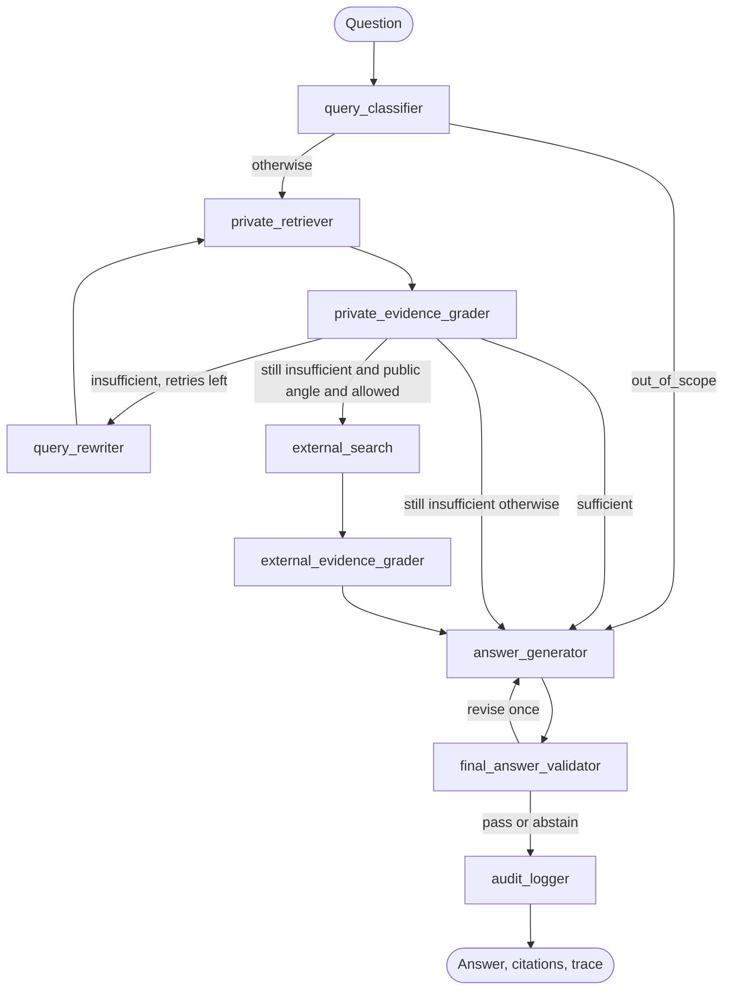

# IT Support Copilot: Private-First Agentic RAG


A locally runnable IT support assistant for employees. It answers from the company's **internal documents first**, grades the evidence it found, rewrites the query and retries when the evidence is weak, uses **public web search only as a graded, clearly labelled fallback**, cites every claim, **abstains** when reliable evidence is missing, and records the full decision path.

> **Demo data:** every document in `data/kb_documents/` is a **synthetic demo document, not a real company policy**. Each file starts with the line `SYNTHETIC DEMO DOCUMENT — NOT A REAL COMPANY POLICY`.
>
> **Demo auth:** the employee/admin roles are a **local demonstration, not authentication or production identity management** (see [Demo authorization](#demo-authorization-and-its-limits)).
>
> **Scope:** this project runs locally (virtualenv or Docker Compose). Deployment is out of scope.

---

## Contents

1. [What it does](#what-it-does)
2. [Architecture](#architecture)
3. [Technology stack](#technology-stack)
4. [Project layout](#project-layout)
5. [What runs locally and what needs the internet](#what-runs-locally-and-what-needs-the-internet)
6. [Setup](#setup)
7. [Running the application](#running-the-application)
8. [Docker](#docker)
9. [Demo authorization and its limits](#demo-authorization-and-its-limits)
10. [Example workflows](#example-workflows)
11. [API](#api)
12. [Document ingestion](#document-ingestion)
13. [Evaluation](#evaluation)
14. [Testing](#testing)
15. [Limitations](#limitations)
16. [Screenshots](#screenshots)

---

## What it does

- Searches internal documents first, using semantic search over Pinecone with `all-MiniLM-L6-v2` embeddings.
- Grades the retrieved evidence (relevance, sufficiency, contradictions, outdated or incomplete content).
- Rewrites the query and retries retrieval when evidence is insufficient (bounded retries).
- Calls Tavily only when private evidence is still insufficient **and** the question has a public-information angle, external search is allowed, and the question contains nothing sensitive.
- Grades external results (credibility, relevance, freshness) and rejects weak ones.
- Generates an answer using only accepted evidence. Citations are resolved by code against real evidence, so the model cannot invent a source.
- Validates the final answer's grounding. If validation fails it revises once, then abstains.
- Shows the real graph execution trace in the UI and stores the full request lifecycle in SQLite.
- Lets an admin upload, re-index and delete documents, and run the evaluation suite.
- Compares the agentic workflow with a simple baseline RAG on the same dataset and corpus.

## Architecture



Node names above are the exact LangGraph node names.

### Routing rules (enforced in `src/copilot/graph/routing.py`)

1. **Private retrieval always runs first** for any in-scope question, even if the classifier says "current information".
2. **Tavily is never called just because the classifier predicts a current-information question.** It needs insufficient private evidence after retries (or a genuine need to supplement sufficient private evidence), the classifier's finding that the question needs current public information (intent `external_current` or `both`; the grader's recommendation alone is never enough), `EXTERNAL_SEARCH_ENABLED` plus the per-request flag, and no sensitive content in the question.
3. A failed retrieval alone is not proof that web search is appropriate: undocumented company-specific questions abstain.
4. Public information never overrides an internal policy, and external answers are labelled.
5. Every loop is bounded: `MAX_REWRITE_RETRIES` (default 2), `MAX_VALIDATION_REVISIONS` (default 1) and `GRAPH_RECURSION_LIMIT`.
6. Retrieved and external text is untrusted evidence, placed in delimited `<evidence>` blocks. It cannot change routing or instructions.
7. Answers that use external evidence start with exactly: `External information: This response uses public vendor information and may not represent your company's internal IT policy.`
8. When no reliable evidence exists the system abstains, recommends the IT Service Desk, and records the abstention reason. If the grader, validator or LLM is unavailable, it fails closed (abstains) rather than guessing.

Search queries are sanitised before leaving the machine (identifiers, private terms and secrets are removed or the search is blocked), and external URLs are validated.

## Technology stack

| Layer | Technology |
|---|---|
| Agent workflow | LangGraph `StateGraph` (typed state, conditional edges, bounded loops) |
| LLM | Groq API (default model `openai/gpt-oss-120b`, set by `GROQ_MODEL`) |
| Embeddings | HuggingFace `sentence-transformers/all-MiniLM-L6-v2` (384 dimensions, runs locally) |
| Vector database | Pinecone serverless (cosine) |
| External search | Tavily |
| Backend | FastAPI + Pydantic v2 |
| Frontend | Streamlit (talks to the API over HTTP only) |
| Audit and metadata | SQLite |
| Packaging | Docker and Docker Compose |
| Language | Python 3.11+ (developed on 3.12) |

All configuration lives in one `Settings` class (`src/copilot/config.py`, read through `get_settings()`). Model names, thresholds, top-k, chunk sizes and URLs are not hard-coded elsewhere. Every variable is listed in `.env.example`.

## Project layout

```
it-support-copilot/
├── README.md, pyproject.toml, requirements.txt
├── .env.example               every setting (copy to .env; never commit .env)
├── Dockerfile, docker-compose.yml, .dockerignore
├── data/
│   ├── kb_documents/          11 synthetic demo documents
│   ├── eval/dataset.json      52 labelled evaluation questions in 8 categories
│   ├── eval/results/          evaluation run outputs (git-ignored)
│   └── sqlite/                app.db (git-ignored)
├── frontend/streamlit_app.py  Streamlit entry point
├── scripts/                   init_db, check_env, check_groq, ingest_kb, search_kb,
│                              ask_baseline, ask_agent, run_api, run_eval
├── src/copilot/
│   ├── config.py, logging_config.py, retry.py, utils.py
│   ├── auth/                  demo roles and access levels
│   ├── db/                    SQLite connection, schema, repository
│   ├── ingestion/             validators, loaders, cleaner, chunker, metadata, ids, pipeline
│   ├── embeddings/            MiniLM embedding service
│   ├── vectorstore/           Pinecone store and the access-filtered retriever
│   ├── llm/                   Groq client (structured output) and prompts
│   ├── search/                Tavily client, query sanitizer, URL validation
│   ├── generation/            evidence blocks, answer generator, citations
│   ├── validation/            citation marker checks
│   ├── graph/                 state, schemas, routing, builder, runner, nodes/ (one file per node)
│   ├── baseline/              baseline RAG (retrieve then generate)
│   ├── audit/                 audit logger and feedback store
│   ├── api/                   FastAPI app, schemas, security, services, routes/
│   ├── ui/                    API client, formatting helpers, views/ (chat, admin, evaluation)
│   └── evaluation/            dataset, metrics, scoring, judge, runner, service, reporting
└── tests/                     unit/, workflow/, api/, integration/
```

## What runs locally and what needs the internet

| Component | Where it runs | Needs |
|---|---|---|
| Embeddings (MiniLM) | Locally (in the Docker image the model is baked in) | Internet only on the first download |
| FastAPI, Streamlit, SQLite, LangGraph | Locally | Nothing |
| Groq LLM | Groq cloud | `GROQ_API_KEY`, internet |
| Pinecone vector index | Pinecone cloud | `PINECONE_API_KEY`, internet |
| Tavily web search | Tavily cloud | `TAVILY_API_KEY`, internet (optional: set `EXTERNAL_SEARCH_ENABLED=false` to disable) |

Unit, workflow and API tests use fakes and need no keys or network.

## Setup

**Prerequisites:** Python 3.11+, free accounts and API keys for [Groq](https://console.groq.com), [Pinecone](https://www.pinecone.io) and [Tavily](https://tavily.com). Docker Desktop is only needed for the Docker route.

The commands below are PowerShell (Windows). On macOS or Linux, activate with `source .venv/bin/activate` and use `/` in paths.

```powershell
cd it-support-copilot
py -3.12 -m venv .venv
.venv\Scripts\Activate.ps1
pip install -r requirements.txt
pip install -e .
copy .env.example .env          # then fill in GROQ_API_KEY, PINECONE_API_KEY, TAVILY_API_KEY
python scripts\check_env.py     # shows which settings are present (never prints values)
python scripts\init_db.py       # creates the SQLite schema
python scripts\check_groq.py    # optional: live Groq connectivity and model check
python scripts\ingest_kb.py     # embeds and indexes the 11 demo documents into Pinecone
python scripts\search_kb.py "How do I connect to the VPN from home?"   # retrieval-only check, no LLM
```

Pinecone is eventually consistent: wait a few seconds after ingestion before searching.

## Running the application

Run these from `it-support-copilot/` with the virtual environment active.

```powershell
# Backend (leave running; interactive docs at http://127.0.0.1:8000/docs)
python scripts\run_api.py

# Frontend (second terminal; http://localhost:8501)
streamlit run frontend\streamlit_app.py

# Command-line questions (no server needed)
python scripts\ask_agent.py "How do I connect to the company VPN from home?" --verbose
python scripts\ask_baseline.py "How do I connect to the company VPN from home?"

# Evaluation (see the Evaluation section)
python scripts\run_eval.py --validate-only

# Tests
pytest tests\unit tests\workflow tests\api
```

The first request after the API starts is slow while the embedding model loads. The API preloads it at startup. If startup hangs on HuggingFace calls, set `$env:HF_HUB_OFFLINE = "1"` after the model has been downloaded once.

## Docker

The image contains no secrets. Keys are read from your `.env` at run time. Ports are published on `127.0.0.1` only.

```powershell
docker compose build                 # several minutes: CPU-only PyTorch and the baked-in embedding model
docker compose run --rm eval         # dataset check (no tokens spent)
docker compose run --rm tests        # unit tests inside the container (the Docker-file checks skip there; they run on the host)
docker compose run --rm ingest       # fills the container's (initially empty) SQLite; re-indexes into Pinecone
docker compose up                    # UI http://127.0.0.1:8501, API docs http://127.0.0.1:8000/docs
```

- State lives in named volumes (`copilot-sqlite`, `copilot-uploads`, `copilot-eval-results`).
- The tool services (`ingest`, `eval`, `tests`) are opt-in and only run with `docker compose run`.
- Do not run a command-line evaluation and an API/UI evaluation at the same time: they share the same Groq rate limits.
- Changing `EMBEDDING_MODEL_NAME` requires `docker compose build` again.

## Demo authorization and its limits

Two roles are supported:

| Role | Can read | Can also |
|---|---|---|
| `employee` | `public`, `internal` documents | Ask questions, give feedback |
| `admin` | `public`, `internal`, `restricted` documents | Upload, re-index and delete documents, run evaluations, read other users' audit records |

Access control is enforced twice: as a Pinecone metadata filter and as a post-filter on the results. Unknown access levels are treated as the most restrictive.

**This is a demonstration, not security.** The caller states its role in the `X-Demo-Role` and `X-Demo-User` headers (the Streamlit sidebar sets them), and nothing verifies the claim. Anyone who can reach the API can claim `admin`. A real deployment would put SSO/OIDC in front and take the identity from a verified token.

## Example workflows

A complete guided walkthrough with pass/fail checklists (scenarios A and B, safety checks, audit, admin) is in [`docs/DEMO.md`](docs/DEMO.md).

All examples are run with `python scripts\ask_agent.py "<question>" --verbose`, which prints the real decision trace. The Streamlit UI shows the same trace. The exact answer text comes from the uploaded documents and the model, so it varies between runs.

**Scenario A: private evidence is sufficient.**
`"How do I connect to the company VPN from home?"`
Expected path: `query_classifier → private_retriever → private_evidence_grader → answer_generator → final_answer_validator → audit_logger`. Tavily is not called. The answer cites the VPN guide with its section.

**Scenario B: private evidence insufficient, public information needed.**
`"What is the latest Microsoft Teams outage guidance?"`
Expected path: private retrieval and grading, up to two `query_rewriter` retries, then `external_search → external_evidence_grader`, then the answer, validation and audit. A grounded answer starts with the external-information warning and cites URLs. If no external source passes grading, the system abstains and recommends the IT Service Desk. Live web results vary, so this question can abstain on some runs.

**Scenario C: private and public evidence together.**
Used only when the classifier says both are needed and the grader reports that the private evidence needs a public supplement. The two kinds of evidence are labelled separately, and public text never overrides internal policy.

**Scenario D: no reliable evidence.**
Both private retrieval and (where allowed) external search fail. The system does not guess: it says reliable information was not found, recommends the IT Service Desk, and records the abstention reason.

**Scenario E: out of scope.**
An unrelated question gets a polite decline with no retrieval and no web search.

Other checks:

```powershell
python scripts\ask_agent.py "latest Teams outage guidance" --no-external          # external search forbidden
python scripts\ask_agent.py "How does the service desk verify a caller?" --role admin   # restricted document, admin only
python scripts\ask_agent.py "How does the service desk verify a caller?"                # same question as employee
```

## API

Interactive documentation is served at `/docs`. Identity headers: `X-Demo-Role`, `X-Demo-User` (demo only).

| Method and path | Purpose | Access |
|---|---|---|
| `POST /chat` | Ask a question; returns answer, citations, decision trace | any role |
| `POST /documents/upload` | Validate and ingest a document | admin |
| `GET /documents` | List documents the caller may see, with ingestion status | any role (filtered) |
| `DELETE /documents/{document_id}` | Delete a document and its vectors | admin |
| `POST /documents/{document_id}/reindex` | Re-embed and re-index a stored document | admin |
| `POST /feedback` | Record positive or negative feedback on an answer | any role |
| `GET /audit/{request_id}` | Full audit record of a request | owner or admin |
| `GET /health` | Application and dependency health (no secrets) | any |
| `POST /evaluation/run` | Start a background evaluation run (409 if one is running) | admin |
| `GET /evaluation/runs`, `/evaluation/runs/{id}`, `/evaluation/runs/{id}/summary` | List runs, status and progress, full metrics | admin |
| `POST /evaluation/runs/{id}/cancel` | Stop the active run after its current case | admin |

## Document ingestion

`copilot.ingestion.pipeline.IngestionPipeline` is independent of Streamlit and is used by the API, the scripts and the tests.

- Supported formats: PDF, DOCX, TXT. Uploads are validated (name, size limit `MAX_UPLOAD_MB`, type, content signature, non-empty text).
- Text is cleaned and split into section-aware chunks (`CHUNK_SIZE`, `CHUNK_OVERLAP`), keeping page numbers and section headings.
- Document and chunk ids are stable. Identical content is skipped; the same name with new content becomes a new version and the old vectors are removed.
- Chunk metadata includes `document_id`, `document_name`, `category`, `department`, `access_level`, `page_number`, `chunk_id`, `uploaded_at` and `version`.
- Status (`pending`, `processing`, `indexed`, `failed`) and errors are tracked in SQLite. Re-indexing and deletion are supported.

## Evaluation

Evaluation is a first-class part of the project and lives in `src/copilot/evaluation/`.

**Dataset:** `data/eval/dataset.json` has 52 labelled questions in 8 categories: direct internal, paraphrased, needs query rewriting, insufficient private evidence, current external information, conflicting documents, unanswerable, out of scope. Each case has the question, the role, the expected route, expected documents, expected answer points, expected citations, whether abstention is expected, and whether external search is allowed. `--validate-only` checks every label against the knowledge base.

**Metrics:**

- **Retrieval:** Recall@K, Precision@K, MRR and nDCG@K, at document and chunk level.
- **Answer:** correctness (deterministic keyword checks), faithfulness, relevance and unsupported claims (optional LLM judge), citation correctness, abstention quality.
- **Agent workflow:** private-first routing accuracy, correct private-only answer rate, unnecessary external search rate, external fallback accuracy, query-rewrite success rate, evidence-grading accuracy, correct abstention rate, final-validation failure rate.
- **System:** average and P95 latency, error rate, ingestion success, token usage and approximate cost.

**Baseline comparison:** the baseline (retrieve then generate) and the agentic workflow run on the same questions, roles and corpus, case by case. Service outages are recorded as errors, never as correct abstentions.

**Running it** (each question costs Groq tokens; the free tier has per-minute and per-day limits):

```powershell
python scripts\run_eval.py --validate-only                       # no network, no cost
python scripts\run_eval.py --per-category 1 --no-judge --delay 10  # small smoke run (8 questions x 2 systems)
python scripts\run_eval.py --per-category 3 --delay 5              # larger run with the judge
python scripts\run_eval.py --list-runs
python scripts\run_eval.py --resume <run_id>                       # continue an interrupted or stopped run
```

Press Ctrl+C once to stop after the current case; the run stays resumable. A circuit breaker stops a run after `EVAL_MAX_CONSECUTIVE_ERRORS` infrastructure errors in a row (for example an exhausted daily quota). Outputs go to `data/eval/results/<run_id>/` (`summary.json`, `cases.csv`, `metrics.csv`, `cases.jsonl`, `retrieval.jsonl`, `config.json`) and run metadata to the SQLite `eval_runs` table. The Streamlit **Admin → Evaluation** tab shows the dashboard: retrieval, answer, routing and external-search metrics, latency and cost, failed cases, and baseline vs agentic.

### Results

Latest clean run, after the routing fix, on a single model: run `20261119T120610Z-f01dbc` (2026-11-19), `openai/gpt-oss-120b`, reranker **off**, LLM judge on, 3 questions per category = **24 questions per system** (48 units, 0 errors), `--per-category 3 --delay 5`, free Groq tier, corpus = the 11 synthetic documents. The run's folder holds `summary.json`, `cases.csv`, `metrics.csv` and `config.json` (which records the settings used).

> **This is a small, single run (24 questions per system, below the dashboard's 30-question threshold).** Differences of a few points are noise, and no winner is declared from it.

| Metric | Baseline RAG | Agentic workflow |
|---|---|---|
| Overall correct | 88% (21/24) | 92% (22/24) |
| Answerable questions answered correctly | 80% (12/15) | 87% (13/15) |
| False abstentions | 20% (3/15) | 13% (2/15) |
| Correct abstentions | 100% (9/9) | 100% (9/9) |
| Hallucinated answers (should have abstained) | 0% (0/9) | 0% (0/9) |
| Citation correct | 92% (11/12) | 91% (10/11) |
| Faithful (LLM judge) | 100% (12/12) | 100% (13/13) |
| Private-first routing accuracy | n/a | 95% (20/21) |
| Unnecessary external searches | n/a | 0% (0/21) |
| External fallback accuracy | n/a | 67% (2/3) |
| Query-rewrite success | n/a | 0% (0/1) |
| Evidence-grading accuracy | n/a | 95% (19/20) |
| Final-validation failures | n/a | 0% (0/24) |
| Error rate | 0% (0/24) | 0% (0/24) |
| Average / P95 latency | 2.2 s / 3.9 s | 23.3 s / 61.6 s |
| Total tokens | 21,980 | 109,792 |
| Approx. cost (USD) | 0.004 | 0.049 |

Retrieval (12 questions with expected documents): document recall@5 1.00, document MRR 1.00, chunk precision@5 0.32, chunk nDCG@5 0.87.

**What this run does and does not show**

- The agentic workflow answered one more question than the baseline (22 vs 21 of 24). That difference is within noise for a sample this size, and it came from live web results (see next point), not from better use of the internal documents. The agentic workflow used about 5 times the tokens and about 10 times the average latency (latency includes free-tier rate-limit waits, so the gap is inflated).
- The baseline cannot search the web by design, so it abstains on the current-information questions E01 to E03. The agentic workflow answered two of the three (E01 and E03) from accepted, cited public sources and abstained on E02. These outcomes depend on live web results: in earlier runs the same questions ended in abstentions, so repeat runs are needed before calling the external path reliable.
- The agentic workflow abstained on C03 ("Do I have to change my password every 90 days?"), a conflicting-documents question the baseline answered. The baseline also scored better on the conflict-handling metric. Conflicting documents remain a weak spot of the agentic path.
- **Routing fix confirmed:** unnecessary external searches were 0 of 21. In the previous run (`20261118T062347Z-eb71dc`, before the fix) one undocumented company-specific question (I02) triggered a public search because a grader recommendation could override the classifier. Only the classifier's `external_current` or `both` intent can now allow a search. In that earlier run the two systems were identical on quality (21/24 each) and external fallback accuracy was 0/3.
- Private-first routing was 20/21: one question skipped private retrieval because the classifier marked it out of scope. The rewrite-success figure (0/1) rests on a single question and says almost nothing.
- Faithfulness comes from an LLM judge of the same model family as the generator, so treat it as a noisy signal. LLM confidence values are used as decision signals, not as calibrated probabilities.
- **Reranker:** the optional cross-encoder reranker (`RERANK_ENABLED`) was off in this run. A matching run with it on is planned; until then no claim is made that it improves retrieval or reduces hallucinations.
- Run it again (and with the full 52 questions, resuming across days if needed) before drawing conclusions.

## Testing

```powershell
pytest tests\unit tests\workflow tests\api         # no keys or network needed
pytest -m integration tests\integration            # live Groq/Pinecone tests, skipped without keys
pytest --cov=copilot tests\unit tests\workflow tests\api
docker compose run --rm tests                      # unit tests inside the container
```

- `tests/unit`: ids, cleaning, chunking, validators, loaders, sanitizer, URL checks, retrieval and evaluation metrics, routing, citations, config, Docker configuration.
- `tests/workflow`: full graph runs with a scripted LLM and fake search, asserting the exact node path for scenarios A to E and the safety rules (for example, Tavily is not called in scenario A).
- `tests/api`: HTTP contract and authorization, the Streamlit app headless, and the evaluation endpoints.
- `tests/integration`: live services, marked `integration`.

## Limitations

- **Demo authentication only** (see above). Do not expose the API or UI to an untrusted network: anyone who can reach them can claim `admin` and spend your API quota.
- **Synthetic knowledge base** of 11 short documents. Results on it say little about a real document set.
- **External results vary.** Tavily returns different pages over time, and official vendor pages are not always returned, so current-information questions can abstain on some runs. This is a safe failure, but it lowers the answer rate.
- **LLM judgements vary.** The graders and the validator are LLM calls, so identical questions can be accepted on one run and rejected on another. Deterministic checks are used wherever possible, and the evaluation reports include the sample size.
- **Free-tier limits.** Groq's free tier has per-minute and per-day token limits that make large evaluation runs slow and can interrupt them (runs are resumable).
- **Known routing observations** from evaluation runs, not tuned on single cases: the unnecessary-search problem (I02, I03) was fixed and re-measured at 0/21; a borderline question can still be classified as out of scope and skip retrieval (one case in the latest run); a correct answer to a conflicting-documents question can fail closed or abstain (C03 in the latest run), and the baseline handled conflicts better; a superseded policy competes with the current one in retrieval because documents carry no current/superseded status.
- **Plain-text first.** PDF and DOCX are supported, but the demo corpus is TXT, and PDF page numbers depend on the file's text layer (scanned PDFs are not OCR'd).
- **No deployment.** There is no TLS, no secrets manager and no multi-user session handling.

## Screenshots

_Add screenshots here after a demo run._

| Screen | File |
|---|---|
| Chat with a private-evidence answer and citations (scenario A) | `docs/screenshots/chat-private.png` |
| Decision trace for the Teams outage question (scenario B) | `docs/screenshots/trace-external.png` |
| External-information warning | `docs/screenshots/external-warning.png` |
| Admin: document management | `docs/screenshots/admin-documents.png` |
| Admin: evaluation dashboard | `docs/screenshots/evaluation-dashboard.png` |
